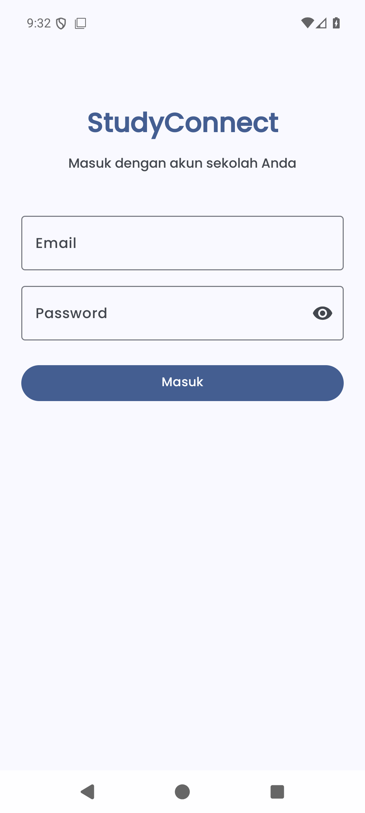

# StudyConnect 📱

[](https://github.com/Zierch/StudyConnect/actions/workflows/android.yml)

Aplikasi mobile **StudyConnect** — tugas akhir SMK. Aplikasi kelas untuk guru dan siswa:
materi, pengumuman, tugas, forum, dan daftar anggota kelas.

> 🔗 Backend ada di repo terpisah: **[StudyConnect-API](https://github.com/Zierch/StudyConnect-API)** (Laravel)

## Status

Login dan pembacaan data sudah tersambung ke StudyConnect-API:

- login email/password, token Bearer disimpan dan dipakai untuk permintaan berikutnya
- beranda menampilkan kelas milik pengguna yang login
- tab Forum, Tugas, dan Orang memuat pengumuman, tugas, dan anggota kelas dari API

Ada juga logout (menu di pojok kanan beranda). Yang belum ada: membuat/mengubah data
(gabung kelas, buat kelas, posting pengumuman, tambah tugas, kirim jawaban). Tombol
untuk itu masih menampilkan pesan "belum tersedia" agar tidak terlihat seperti berfungsi.

## Screenshot

Diambil dari emulator Pixel 7 (Android 16) yang tersambung ke API lokal:

| Login | Beranda | Kelas · Forum |
| --- | --- | --- |
|  |  |  |

| Kelas · Tugas | Kelas · Orang |
| --- | --- |
|  |  |

Data pada tangkapan layar adalah data contoh yang dibuat lewat API, bukan data sekolah.

## Rencana fitur

- Login / register guru & siswa — login **selesai**, register belum
- Daftar kelas — **selesai**; gabung lewat kode kelas & buat kelas belum
- Tugas: daftar tugas **selesai**; esai, pilihan ganda, unggah berkas, pengumpulan & penilaian belum
- Forum: daftar pengumuman **selesai**; posting dan komentar belum
- Materi dan daftar siswa: daftar siswa **selesai**; materi belum

## Tech stack

| Bagian | Teknologi |
|---|---|
| Bahasa | Java 8 |
| UI | XML + ViewBinding, Material Design 3, Navigation Component |
| Dependency injection | Dagger Hilt (dependency sudah ada, `@HiltAndroidApp` belum dipasang) |
| HTTP client | Retrofit 2 + Gson |
| Min / target SDK | 24 / 34 |
| IDE | Android Studio (AGP 8.6) |

Versi dependency terpusat di `gradle/libs.versions.toml`.

## Struktur

```
app/src/main/java/com/example/studyconnect/
├── MainActivity.java               # beranda: daftar kelas dari API
├── data/
│   ├── ApiClient.java              # Retrofit tunggal (baseUrl 10.0.2.2:8000)
│   ├── ApiService.java             # endpoint login, kelas, siswa, tugas, pengumuman
│   ├── Api.java                    # pembungkus Call + penanganan galat
│   ├── Session.java                # token, peran, nama, dan id pengguna
│   └── *Item.java                  # model respons API
├── di/AppModule.java               # provider SharedPreferences (Hilt belum aktif)
├── ui/
│   ├── auth/LoginActivity.java     # login ke API
│   ├── ClassAdapter.java
│   └── class_ui/
│       ├── ClassActivity.java      # toolbar + tiga tab (Forum, Tugas, Orang)
│       ├── ForumFragment.java      # pengumuman
│       ├── ClassAssignmentFragment.java
│       └── StudentListFragment.java
└── utils/SharedPreferencesManager.java
```

## Menjalankan

1. Nyalakan backend [StudyConnect-API](https://github.com/Zierch/StudyConnect-API):

   ```bash
   cd StudyConnect-API
   php artisan serve
   ```

2. Buka folder ini di Android Studio, tunggu Gradle sync, lalu Run.
   Atau lewat terminal (pastikan `ANDROID_HOME` sudah diatur dan ada emulator/device aktif):

   ```bash
   ./gradlew installDebug
   ```

3. Alamat API ada di `app/src/main/java/com/example/studyconnect/data/ApiClient.java`:

   ```java
   private static final String BASE_URL = "http://10.0.2.2:8000/api/";
   ```

   `10.0.2.2` adalah localhost mesin bila dilihat dari emulator Android. Untuk perangkat
   fisik, ganti dengan IP LAN mesin (mis. `http://192.168.1.10:8000/api/`).

4. Login memakai akun yang sudah terdaftar di API:

   ```bash
   curl -X POST http://127.0.0.1:8000/api/register \
     -H 'Content-Type: application/json' -H 'Accept: application/json' \
     -d '{"name":"Bu Sari","email":"sari@sekolah.test","role":"teacher","password":"rahasia123"}'
   ```

## Catatan

- `127.0.0.1` di dalam emulator menunjuk ke emulator itu sendiri. Untuk menjangkau
  `php artisan serve` di mesin host, pakai `10.0.2.2`. Untuk device fisik, pakai IP LAN
  mesin (mis. `http://192.168.1.10:8000/api/`).
- `AndroidManifest.xml` mengaktifkan `usesCleartextTraffic` karena API pengembangan berjalan
  di HTTP. Untuk rilis, pakai HTTPS dan hapus flag itu.
- Belum ada class `@HiltAndroidApp`; tambahkan `Application` beranotasi tersebut
  (dan daftarkan di manifest) sebelum memakai injeksi Hilt di Activity/Fragment.
