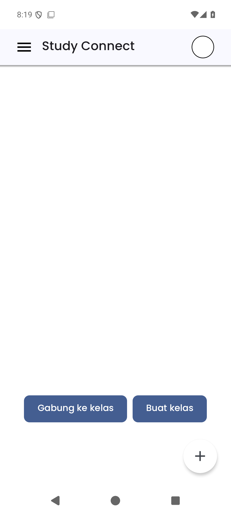
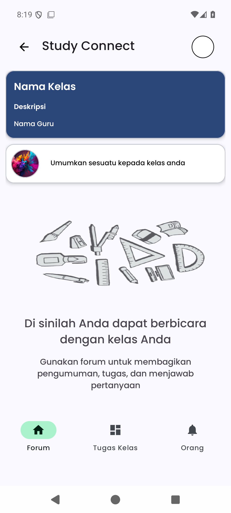
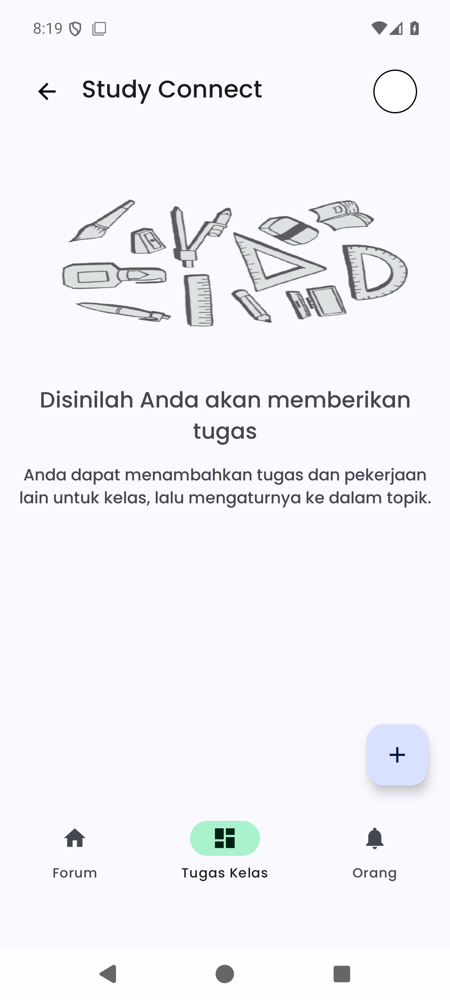
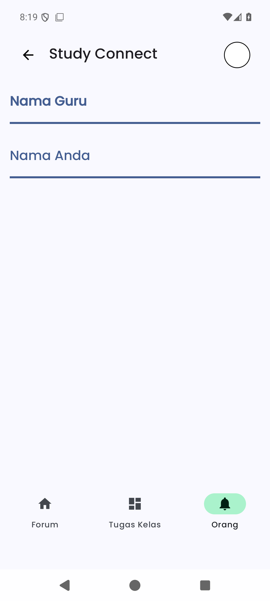

# StudyConnect 📱

Aplikasi mobile **StudyConnect** — tugas akhir SMK. Aplikasi kelas untuk guru dan siswa:
materi, pengumuman, tugas, forum, dan daftar anggota kelas.

> 🔗 Backend ada di repo terpisah: **[StudyConnect-API](https://github.com/Zierch/StudyConnect-API)** (Laravel)

## Status

Tahap UI. Layar beranda dan layar kelas (tab Forum, Tugas, Orang) sudah bisa dibuka
dan dinavigasi. Lapisan jaringan masih kerangka: `ApiService` belum berisi endpoint,
jadi semua layar menampilkan keadaan kosong dan tombol aksi belum menyimpan apa pun.

Artinya: aplikasi bisa di-build dan dijalankan untuk melihat UI, belum bisa login atau
mengambil data dari API.

## Screenshot

Diambil dari emulator Pixel 7 (Android 16), isinya keadaan kosong karena API belum
tersambung:

| Beranda | Kelas · Forum |
| --- | --- |
|  |  |

| Kelas · Tugas | Kelas · Orang |
| --- | --- |
|  |  |

## Rencana fitur

- Login / register guru & siswa (token Bearer dari API)
- Daftar kelas, gabung lewat kode kelas, buat kelas (guru)
- Tugas: esai, pilihan ganda, unggah berkas + pengumpulan & penilaian
- Forum diskusi kelas (teks & gambar)
- Materi, pengumuman, dan daftar siswa per kelas

## Tech stack

| Bagian | Teknologi |
|---|---|
| Bahasa | Java 8 |
| UI | XML + ViewBinding, Material Design 3, Navigation Component |
| Dependency injection | Dagger Hilt (dependency sudah ada, `@HiltAndroidApp` belum dipasang) |
| HTTP client | Retrofit 2 + Gson |
| Min / target SDK | 24 / 34 |
| IDE | Android Studio (AGP 8.6) |

Versi dependency terpusat di `gradle/libs.versions.toml`.

## Struktur

```
app/src/main/java/com/example/studyconnect/
├── MainActivity.java               # beranda: tombol gabung/buat kelas
├── data/ApiService.java            # antarmuka Retrofit (masih kosong)
├── di/AppModule.java               # provider Retrofit + SharedPreferences
├── ui/class_ui/
│   ├── ClassActivity.java          # toolbar + tiga tab (Forum, Tugas, Orang)
│   ├── ForumFragment.java
│   ├── ClassAssignmentFragment.java
│   └── StudentListFragment.java
└── utils/SharedPreferencesManager.java
```

## Menjalankan

1. Nyalakan backend [StudyConnect-API](https://github.com/Zierch/StudyConnect-API):

   ```bash
   cd StudyConnect-API
   php artisan serve
   ```

2. Buka folder ini di Android Studio, tunggu Gradle sync, lalu Run.
   Atau lewat terminal (pastikan `ANDROID_HOME` sudah diatur dan ada emulator/device aktif):

   ```bash
   ./gradlew installDebug
   ```

3. Sesuaikan `baseUrl` di `app/src/main/java/com/example/studyconnect/di/AppModule.java`
   bila server tidak berjalan di localhost:

   ```java
   .baseUrl("http://10.0.2.2:8000/api/")   // dari emulator Android ke localhost mesin
   ```

## Catatan

- `127.0.0.1` di dalam emulator menunjuk ke emulator itu sendiri. Untuk menjangkau
  `php artisan serve` di mesin host, pakai `10.0.2.2`. Untuk device fisik, pakai IP LAN
  mesin (mis. `http://192.168.1.10:8000/api/`).
- `AndroidManifest.xml` belum memuat `<uses-permission android:name="android.permission.INTERNET" />`
  dan belum mengaktifkan cleartext HTTP — keduanya perlu ditambahkan saat integrasi API mulai dipakai
  (atau pakai HTTPS).
- Belum ada class `@HiltAndroidApp`; tambahkan `Application` beranotasi tersebut
  (dan daftarkan di manifest) sebelum memakai injeksi Hilt di Activity/Fragment.
